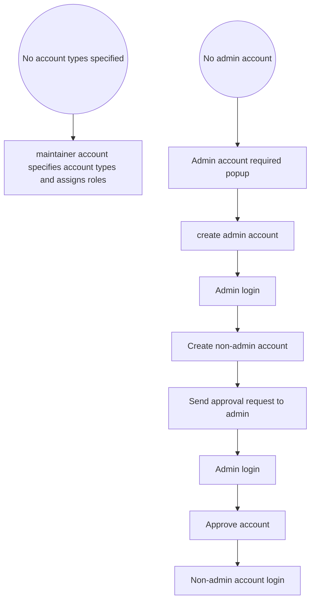
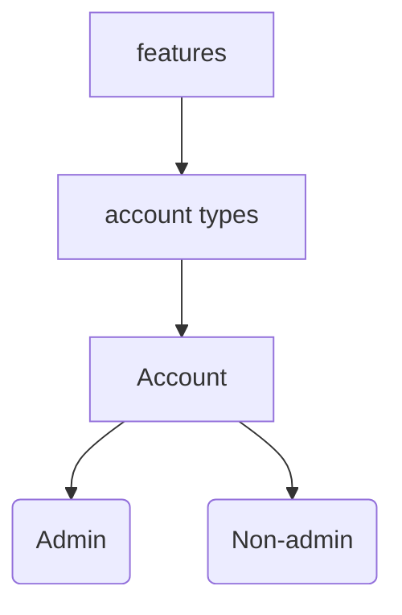

<h2> Introduction </h2>
Well, first there has to exist at least 3 types of accounts in the system:

1. "Regular accounts" - with a set of features accessible to users with such accounts.
2. Admin accounts - more privileges.
3. Maintainer accounts: These are for me and whoever I decide to have help me run some 
maintenances tasks in the future inshallah.

- Every system has to have a maintainer account built-in. With access to maintenance-related features. Even though I haven't had these clearly defined yet.
- A maintainer account is created before anything else, including an admin account.
  A maintainer account can create ACCOUNT TYPES and assign access to features for each
  type of account. The feature list is an enum provided by the dependent project.
- Then, an admin account has to be created first before non-admin accounts can be created.
- After it's created, an admin account can then approve of other accounts' creation.
- Logic flow goes like this:
- 
No account types specified -> maintainer account creates 
No admin account -> create-admin-account-popup -> admin account created
-> account(admin) login
OR
-> create-non-admin-account -> send approval request to admin
-> account(admin) login -> approve account.
-> non-admin-account-login.

